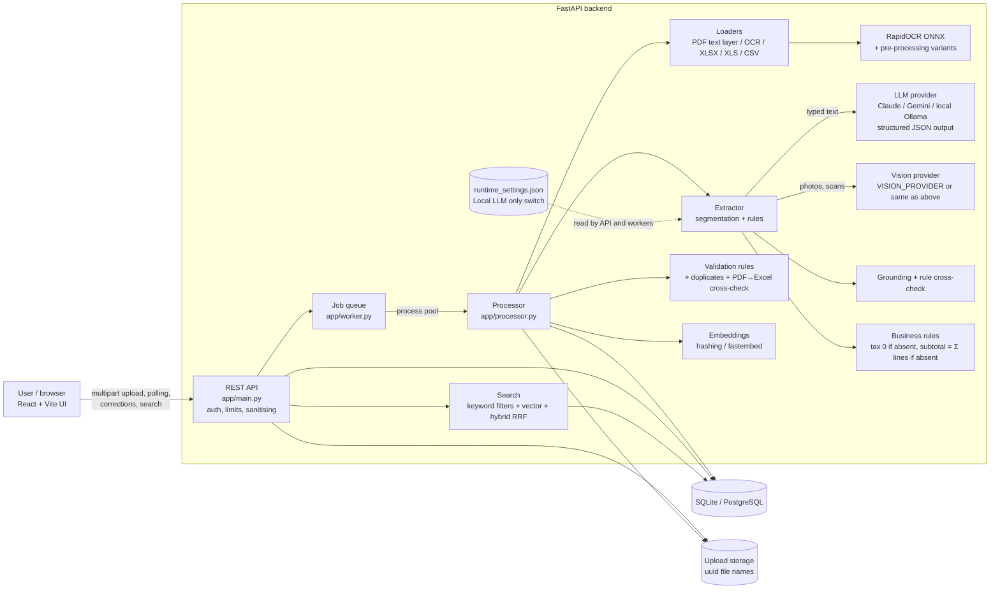
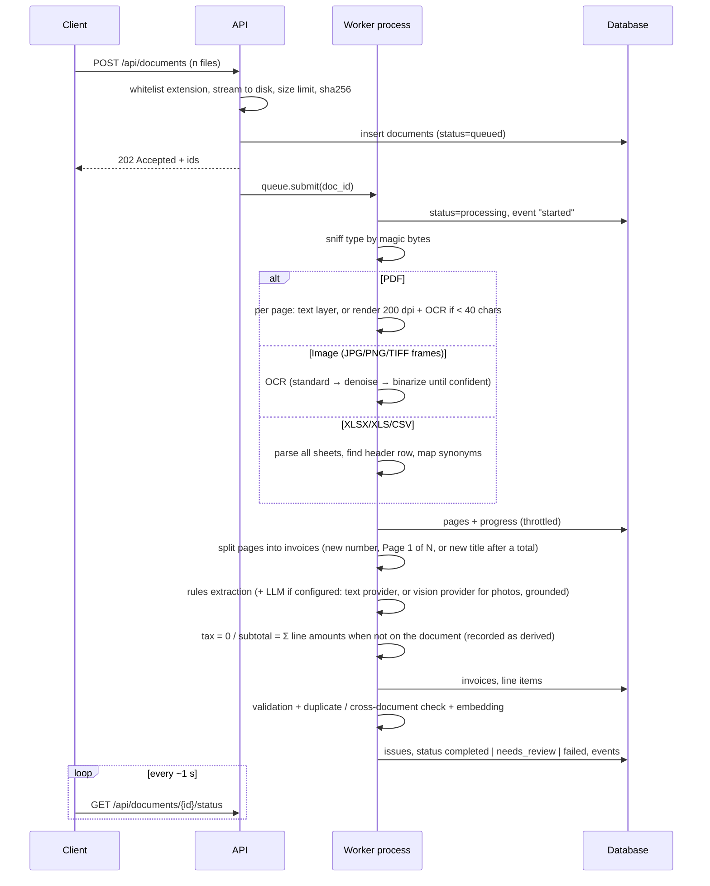
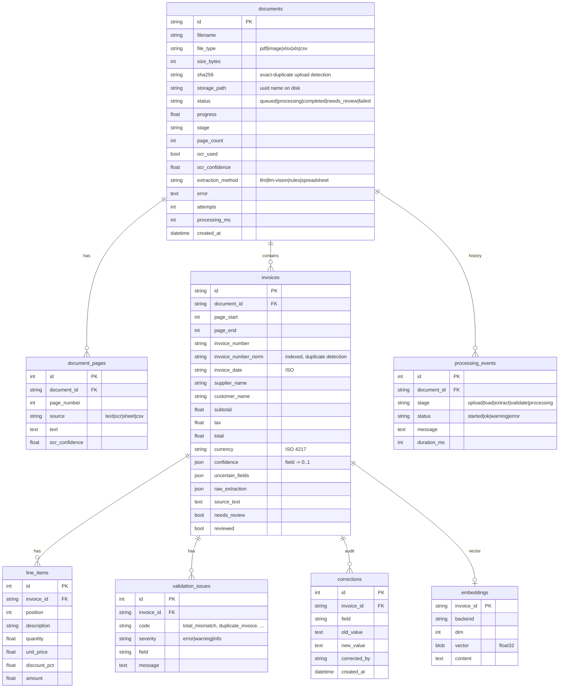

# Architecture

## System overview

### Processing pipeline (per document)

## Design decisions

| Decision | Choice | Why |
|---|---|---|
| Backend language | **Python / FastAPI** instead of NestJS | OCR, PDF, pandas and the Anthropic SDK are all Python; one language for API + pipeline avoids a second service boundary. FastAPI gives typed validation and OpenAPI docs at `/docs`. |
| OCR | **RapidOCR (PaddleOCR models on ONNX Runtime)** | `pip install` only — no system Tesseract binary — and better accuracy on noisy scans in our tests. Tesseract is supported as a fallback if installed. |
| Poor-quality images | Up to three pre-processing variants (autocontrast → median denoise + unsharp → Otsu binarisation), keep the most confident | Retries cost time only when the first pass is not confident. |
| Digital vs scanned PDF | Per page: use the text layer if it has ≥ 40 chars, otherwise render and OCR | Mixed PDFs (some pages scanned) are common; cheap pages stay cheap. |
| Layout | Lines are rebuilt from word/box coordinates | Keeps table rows on one line, which makes line-item parsing reliable for both text-layer and OCR output. |
| Extraction | **Rules always + an LLM when one is configured** (Claude, Gemini or local Ollama) | Rules are free, deterministic, and act as a second opinion. The LLM handles unseen layouts. Every LLM value is *grounded* (must appear in the source text) and compared with confident rule values; disagreements are flagged instead of silently trusted. |
| LLM providers | **Claude, Gemini (free tier) or a local model via Ollama** (`LLM_PROVIDER`), same prompt and JSON schema for all | Claude for best quality; Gemini when there's no budget; Ollama (e.g. qwen3.5:4b) when documents must not leave the machine. Measured: the local 4B model scored 100 % on the synthetic set but needs ~10–16 s per page on this laptop, and misreads handwriting. |
| Hybrid routing | `VISION_PROVIDER` sends only photos/scans to a different provider | Small local models are good on typed text but weak on handwriting; hybrid keeps typed documents local and sends photos to Gemini. A failed vision call falls back to the text model, then to the rules. |
| Local-only switch | UI toggle → `PUT /api/settings/llm` → `backend/data/runtime_settings.json` | Worker processes are separate, so an in-memory flag wouldn't reach them; each process re-reads the small file when its mtime changes. Survives restarts; written atomically. |
| Model traceability | Each LLM result records `<method> <model> <ms>` in its notes; the API exposes it as `model` (invoice) and `models` (document) | Reviewers can see which model produced every value (e.g. after a Gemini → Flash-Lite fallback). |
| "Don't invent values" | Nullable JSON schema, `uncertain_fields`, grounding check, confidences | Missing → `null`; heuristic or unverifiable → listed as uncertain → manual review. |
| Missing tax / subtotal | After extraction: tax = 0 when the document shows none; subtotal = Σ line amounts when absent and every line has an amount. Recorded in `derived_fields` and labeled in the UI | A business rule, not a guess by the model: the value is computed, shown as such, and the total check still runs, so a misread line is still flagged. Printed values are never overwritten. |
| Large files (≈1000 pages) | Page-by-page streaming, per-page error isolation, invoice segmentation, parallel LLM calls per segment | One damaged page does not fail the file; the LLM never sees the whole 1000 pages at once; oversized segments fall back to rules with a note (never silently truncated). |
| Splitting a PDF into invoices | A page starts a new invoice if it shows a different labeled invoice number, says "Page 1 of N", or opens with a document title (Invoice / Bill / Challan / Receipt…) after the previous invoice's closing total. "Page 2 of N" / "continued" pages stay attached | Local bills often print the number without an "Invoice No" label; a scanned bundle of 5 such bills was read as 1 invoice before this rule. The rules-only evaluation gives identical results before and after (no missed or extra invoices). |
| Background jobs | In-process **process pool**; state in the DB; restart recovery | OCR is CPU-bound, so processes avoid GIL contention — measured API latency stays ~10 ms while 6 workers OCR. ONNX threads per worker are capped to `cpu_count / workers` (measured on a 12-thread laptop: without the cap, 5 OCR documents processed in parallel took ~35 s each because of CPU oversubscription; with it ~19 s each, and the 20-file mixed batch finished in 28 s). Swap-in path for multi-host scale: run `process_document(doc_id)` from Celery/RQ/BullMQ workers on Redis. |
| Database | **SQLite (WAL) by default, PostgreSQL via `DATABASE_URL`** | Zero-setup for review; the same SQLAlchemy models run on Postgres (Dockerfile + compose provided). |
| Vector search | Vectors stored in the `embeddings` table, cosine in NumPy with an in-memory matrix cache; hybrid = reciprocal-rank fusion with keyword hits | Fine for tens of thousands of invoices on one node. For millions: pgvector or Qdrant — only `search.semantic_search` changes. |
| Embeddings | `fastembed` (BAAI/bge-small, real sentence embeddings) when installed; otherwise a dependency-free hashing embedder (word + bigram + char-4-gram features) | Hashing works offline and handles typos/partial names, but it is *lexical*, not truly semantic — documented honestly. |
| Duplicates vs cross-verification | Same invoice number + supplier in two PDFs/images → `duplicate_invoice`; in a PDF *and* a spreadsheet → automatic PDF↔Excel comparison (`cross_check_ok` / `cross_check_mismatch`) | The brief asks for both duplicate detection and PDF↔Excel verification; an invoice appearing in the ERP export is expected, not a duplicate. Manual multi-document comparison via `POST /api/crossverify`. |
| Money comparison tolerance | Absolute 0.02 (line sums: 0.01 per line), no relative tolerance | A 0.5 % relative tolerance hid a real $100 error on a $33k invoice during evaluation, so it was removed. |

## Database schema

## Validation rules

| Code | Severity | Rule |
|---|---|---|
| `missing_field` | error / warning | invoice number, date, supplier, customer, total, currency required; subtotal/tax recommended |
| `invalid_number`, `negative_amount`, `implausible_amount` | error / warning | amounts must be numbers, non-negative (credit notes warned), < 1e9 |
| `total_mismatch` | error | subtotal + tax ≠ total (± 0.02) |
| `line_items_mismatch` | error | Σ line amounts ≠ subtotal (or total − tax) |
| `line_item_math` | error | quantity × unit price ≠ line amount |
| `tax_missing`, `total_below_subtotal`, `implausible_tax_rate` | error / warning | internal consistency |
| `supplier_equals_customer` | error | typical mis-extraction |
| `future_date`, `invalid_date`, `implausible_date`, `unknown_currency` | warning / error | sanity checks |
| `duplicate_invoice` | error | same normalised number + supplier already seen in another PDF/image (or same file) |
| `cross_check_mismatch` / `cross_check_ok` | error / info | same invoice in a PDF/image and a spreadsheet differs / matches |
| `uncertain_value`, `low_confidence` | warning | extractor unsure (OCR confidence, heuristic match, LLM ungrounded or disagreeing with rules) |

Before these rules run, a missing tax is set to 0 and a missing subtotal to the sum of the line amounts
(see "Missing tax / subtotal" above). Because of that, an untaxed invoice whose lines don't add up to the
printed total is reported as `total_mismatch`, not `missing_field`.

An invoice **needs manual review** if it has any error, any uncertain/low-confidence field, or a duplicate flag. Human corrections are logged in `corrections`, set confidence to 1.0, and trigger re-validation.

## Security measures

- Optional API key (`X-API-Key`, constant-time compare); `/api/health` stays open for load balancers.
- Upload whitelist by extension **and** content sniffing (magic bytes); renamed binaries are rejected.
- Streaming upload with a size cap; max files per request; decompression-bomb guard for images.
- Files stored under random UUID names; client filenames sanitised (path traversal stripped); download endpoint checks the resolved path stays inside the storage dir.
- Server paths are scrubbed from error messages returned to clients.
- Data residency: with `LLM_PROVIDER=ollama` (or the *Local LLM only* switch) no document content leaves the
  machine. In hybrid mode photos are sent to Gemini; on its free tier Google may use the content.
- The local-only switch is an `/api` endpoint, so it's covered by the API key when one is set.
- ORM-only database access (no string-built SQL); strict Pydantic input models; restrictive CORS; `nosniff`, `X-Frame-Options: DENY`, `no-referrer` headers.
- Docker image runs as a non-root user.
- Not implemented (would be next for production): per-user auth/RBAC (OIDC), rate limiting, malware scanning of uploads, encryption at rest for stored files.
